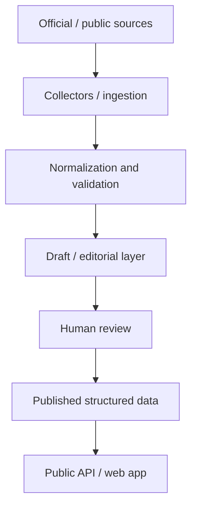

# VeraPolitica

An evidence-first civic-tech platform for structured, verifiable, and accessible political information.

VeraPolitica collects official and public sources, keeps raw evidence, and publishes only reviewed records. Politicians do not edit their own public profiles. Automation can prepare drafts; it does not become public truth by itself. Optional AI can help extract or explain published data, but it is not the source of political assessments.

<!-- Screenshot placeholder: add a public citizen-archive image here (for example docs/images/public-profile.png) once a cleared screenshot of /app/ is available. Do not use admin or editorial UI. -->

## At a glance

| | Current, verified figure | Source |
| --- | --- | --- |
| Territorial reference | 20 regions, 7,894 current municipalities | ISTAT workbook documented in [territorial-sources.md](docs/territorial-sources.md) (state through 21 February 2026) |
| Ask VeraPolitica evaluation | 54 synthetic cases (deterministic baseline 54/54); 45 real-corpus cases | [ask_verapolitica_evaluation.md](docs/ask_verapolitica_evaluation.md) |
| Release | PRE-VPS release candidate — backend is production-oriented; first VPS is not live | [production_deployment.md](docs/production_deployment.md) |

These numbers describe documented reference data, an engineering benchmark, and release status. They are not a claim about live production coverage or model accuracy.

## Key features

- **Political profiles** — Published identity, career, positions, and citations from official sources.
- **Official-source ingestion** — Senato, Camera, Governo, ISTAT, and DAIT collectors feed one source-independent pipeline.
- **Promise tracking** — Explicit pledges are stored separately from legislative proposals and shown with a public status.
- **Evidence-backed assessments** — Published verdicts cite official excerpts; they are not LLM-authored public truth.
- **Ask VeraPolitica** — Retrieval-first answers over published data, with a deterministic fallback.
- **Spiegami questa promessa** — Read-only explanation of an already published pledge assessment.
- **Human editorial review** — Drafts, identity uncertainty, and publications require an explicit human decision.
- **Municipal and regional data** — ISTAT territories and current office-holder feeds, without inventing politicians from names.
- **Public search** — One read-only search across published politicians, proposals, territories, and civic records.
- **Production infrastructure** — PostgreSQL, Docker Compose, Alembic migrations, Caddy/HTTPS target, and backups.

## How it works

Deterministic processing is the main path. AI is optional and sits beside it.



Where optional AI may assist:

- extraction of unstructured official documents into **reviewable drafts only**
- synthesis of Ask / Spiegami answers from **already published** facts
- never auto-publication of politician profiles, pledges, or assessments

Raw responses are stored. Meaningful changes are detected with canonical hashes. Unsafe identity matches become review cases instead of guessed links. Details: [architecture.md](docs/architecture.md), [data-model.md](docs/data-model.md).

## Data integrity and editorial model

- **Raw sources are preserved.** Ingested payloads stay on disk with hashes; the public site does not replace the source.
- **Published records carry evidence.** Visible facts point back to official citations, not to reviewer notes.
- **Draft and published are separate.** Pending, rejected, and unpublished material never appear on the public API or `/app/`.
- **Humans approve publication.** Ingestion, matching, and AI extraction can create drafts. Only an explicit review action publishes.
- **Identity is not guessed.** Automatic matching uses an exact official identifier or name plus exact birth date. Ambiguous cases go to editorial review.
- **Politicians do not self-edit** the public archive.
- **Verdicts are not autonomously published by an LLM.** Scoring and assessment publication stay in the editorial/scoring pipeline. See [scoring-methodology.md](docs/scoring-methodology.md).

## AI in VeraPolitica

VeraPolitica is not an autonomous AI political fact-checker. Production can run with the LLM provider disabled.

**Ask VeraPolitica** (`POST /ask`) is retrieval-first over published politicians, pledges, statuses, topics, and sources. Intent parsing is deterministic. Optional LLM synthesis rewrites retrieved facts. If the provider is off, invalid, or contradictory, a deterministic answer is used. [ask_verapolitica.md](docs/ask_verapolitica.md)

**Spiegami questa promessa** explains a published pledge state and its stored evidence. It is read-only and does not score or publish. It has a deterministic fallback. [ai_explain_pledge.md](docs/ai_explain_pledge.md)

**Document extraction** is an optional operator path for official HTML or text-based PDF. Output becomes reviewable drafts only. OCR, embeddings, RAG, and web crawling are not implemented. Extraction is not required for production. [ai-evaluation.md](docs/ai-evaluation.md)

## Tech stack

| Area | Current stack |
| --- | --- |
| Backend | Python, FastAPI, SQLAlchemy, Pydantic, Alembic |
| Database | SQLite for tests and local demos; PostgreSQL for production |
| Frontend | Vanilla HTML, CSS, and JavaScript (`frontend/app/`) |
| Infrastructure | Docker, Docker Compose, GitHub Actions, Caddy as the first-VPS HTTPS proxy |
| Testing | pytest; optional PostgreSQL integration tests (`pytest -m postgres`) |
| Optional AI | Configurable LLM provider (off by default); tests use a fake provider |

Redis, vector indexes, frontend frameworks, and a live public cloud staging environment are not part of the current stack.

## Project structure

```text
backend/     FastAPI app, domain services, collectors, scoring
frontend/     Public citizen UI and local editorial demo UI
scripts/      Ingestion, demo, review, backup, and operator CLIs
tests/        pytest suite (API, pipeline, scoring, UI, e2e)
docs/         Architecture, API, scoring, security, and deploy docs
evaluation/   Versioned gold sets for Ask and extraction
alembic/      Production PostgreSQL migrations
data/         Local/demo databases, fixtures, and raw storage (not production)
```

## Local development

Recommended path: the **unified demo**. It is the fullest local presentation (profiles, pledges, Ask, Spiegami) and does not touch production data.

```bash
python -m venv .venv
source .venv/bin/activate
pip install -r backend/requirements.txt
```

If the unified database is not built yet:

```bash
python -m scripts.prepare_unified_demo --seed-from-ceo
```

Then start it:

```bash
./scripts/run_unified_demo.sh
```

- Public app: http://127.0.0.1:8000/app/
- Example profile: http://127.0.0.1:8000/app/?politician=206
- Health: http://127.0.0.1:8000/health/live

A smaller synthetic demo (`./scripts/run_demo.sh`) is enough for the editorial publication boundary (Anna Rossi published, Luca Bianchi pending). Presenter notes: [demo.md](docs/demo.md).

Local defaults live in `.env.example`. Do not copy production secrets into the README or into git. Admin routes require a bearer token; see [api-contract.md](docs/api-contract.md).

## Testing and quality

```bash
python -m pytest -q
```

GitHub Actions (Backend CI) runs that suite, `compileall`, Alembic upgrade checks, a PostgreSQL job, and a Docker image build on `main` and pull requests.

Optional local PostgreSQL tests:

```bash
pytest -q -m postgres
```

The suite uses temporary SQLite databases, mocked HTTP, and fixtures. It does not call live Senato, Camera, or Governo endpoints. Publication-boundary, admin-auth, and e2e review tests are included. See [security.md](docs/security.md).

## Production status

The repository is a **PRE-VPS release candidate**. The backend is built for a containerized VPS (PostgreSQL, compose `db` → `migrate` → `web`, Caddy/HTTPS, backups). The first VPS is not treated as live in this documentation.

- PostgreSQL is the production database; the app does not auto-migrate on startup.
- Scheduler and LLM provider stay off unless explicitly configured.
- `python -m scripts.prepare_demo` refuses `VERAPOLITICA_ENV=production`.

Do not follow README snippets as the deploy procedure. Use:

- [production_deployment.md](docs/production_deployment.md) — first VPS
- [first_deploy_checklist.md](docs/first_deploy_checklist.md)
- [production-runbook.md](docs/production-runbook.md) — day-2 operations
- [production_containers.md](docs/production_containers.md)
- [backup_and_restore.md](docs/backup_and_restore.md)
- [release-checklist.md](docs/release-checklist.md)

## Further documentation

| Topic | Document |
| --- | --- |
| Architecture | [docs/architecture.md](docs/architecture.md) |
| Data model | [docs/data-model.md](docs/data-model.md) |
| Public / admin API | [docs/api-contract.md](docs/api-contract.md) |
| Search | [docs/search.md](docs/search.md) |
| Scoring and pledges | [docs/scoring-methodology.md](docs/scoring-methodology.md) |
| Civic records | [docs/civic-features.md](docs/civic-features.md) |
| Territorial sources | [docs/territorial-sources.md](docs/territorial-sources.md) |
| Scheduled jobs | [docs/scheduled-jobs.md](docs/scheduled-jobs.md) |
| Database and migrations | [docs/database-and-migrations.md](docs/database-and-migrations.md) |
| Configuration | [docs/production_configuration.md](docs/production_configuration.md) |
| Security | [docs/security.md](docs/security.md), [docs/production_security.md](docs/production_security.md) |

Operator CLIs for ingestion, bootstrap, drafts, and review remain in `scripts/` and the documents above. They are not required to understand or run the public demo.
